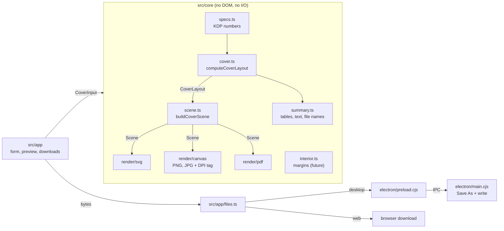

# Architecture

KDP Perfect is a TypeScript app with a **pure core** and thin shells around it. The same code runs as an Electron desktop app and as a static web app.

## Layers

| Layer | Path | Rules |
| --- | --- | --- |
| **Core** | `src/core` | Pure functions. No `window`, `document` or Node APIs, with one exception: `render/canvas.ts` needs a `<canvas>` and is only called from the UI. Units are **inches** everywhere; conversion happens at the edges. |
| **UI** | `src/app` | Vanilla TypeScript and CSS. Reads the form into a state object, calls the core, writes DOM. No framework, so the bundle stays small and there is nothing to migrate. |
| **Desktop shell** | `electron/` | Hosts the built UI, provides native Save As, and nothing else. |

## The pipeline

1. **`specs.ts`** holds every KDP constant, paper type, trim size and page limit (see [KDP-SPECS.md](KDP-SPECS.md)).
2. **`computeCoverLayout(input)`** returns a `CoverLayout`: the canvas, the trim box, the back/spine/front panels, the safe areas, the spine text zone, the barcode box, sorted guide positions and a list of warnings. Coordinates are inches from the top-left of the bleed edge. This is where all KDP maths lives, and it is unit-tested against Amazon's calculator.
3. **`buildCoverScene(layout, {mode, dpi})`** turns the layout into a `Scene`: a flat list of rectangles, lines and text. Two modes: `template` (white page, tints, labels) and `overlay` (transparent, guides only).
4. **Renderers** walk the scene: SVG (string), canvas (PNG/JPG, tagged with DPI by `raster-meta.ts`), PDF (`pdf-lib`, page size = canvas size in points). Because every export consumes the same scene, they can't drift apart, and the on-screen preview is the SVG renderer.

### Why a scene graph?

Adding a guide or label is a one-place change that shows up in the preview, the PNG, the JPG and the PDF. Renderers stay tiny and dumb.

### Actual-size exports

- **PDF**: page size is `inches × 72` points, exact. Vector, so any zoom is sharp.
- **PNG / JPG**: pixels = `round(inches × DPI)`. `raster-meta.ts` writes a `pHYs` chunk (PNG) or JFIF density (JPG), so design tools open the file at its physical size. Rounding to whole pixels can leave the image up to half a pixel short or long (1/600" at 300 DPI).
- JPG has no alpha channel, so the transparent overlay is PNG/PDF only; the UI disables JPG for it.

## Desktop vs web

| Concern | Desktop (Electron) | Web |
| --- | --- | --- |
| Entry | `electron/main.cjs` loads `dist/index.html` (or the Vite dev server) | Serve `dist/` from any static host |
| Saving files | `window.kdpDesktop.saveFile` → IPC → native dialog → `fs.writeFile` | `<a download>` with a Blob URL |
| Detection | `src/app/files.ts` checks for `window.kdpDesktop` | falls through to the browser path |
| Settings | `localStorage` (per-app profile) | `localStorage` |

To publish the web version: `npm run build`, upload `dist/`. `vite.config.ts` uses a relative `base`, so it works from a sub-path (GitHub Pages) too. The optional [Pages workflow](../.github/workflows/pages.yml) does this.

## Electron security model

- `contextIsolation: true`, `nodeIntegration: false`, `sandbox: true`. The page cannot touch Node.
- The preload exposes exactly one function, `saveFile`. The main process checks the sender's URL, validates the file name (basename only, allow-listed extensions), bounds the size, and lets the **user** choose the location in a native dialog.
- Navigation is locked to the app's own URL; `window.open` is denied (https links open in the OS browser).
- A strict Content-Security-Policy is injected into `index.html` at build time (`vite.config.ts`): no remote scripts, no network connections.

## Testing

| Layer | Tool | Notes |
| --- | --- | --- |
| Maths | Vitest | Golden data from Amazon's calculator for all 16 sizes, plus geometry and validation rules |
| Scene and renderers | Vitest | Every shape stays inside the canvas for every preset × paper × direction; PDF re-parsed with `pdf-lib`; SVG structure; PNG/JPG DPI patching byte by byte |
| Desktop | `npm run smoke` | Launches real Electron (or a packaged exe with `--exe`), drives the UI over the DevTools protocol, downloads PNG/JPG/PDF through the real IPC path, inspects the files |

## Extending

- **New trim size or paper type**: add it to `src/core/specs.ts`, add the golden values if you have a source, update [KDP-SPECS.md](KDP-SPECS.md).
- **New guide or label**: change `src/core/scene.ts`; every export picks it up. Add a bounds/overlap test if it adds text.
- **New export format**: add a renderer in `src/core/render/`, a button state in `src/app/ui.ts`, and an extension in the `SAVE_TYPES` allow-list in `electron/main.cjs`.
- **New tool (e.g. the interior formatter)**: add a module under `src/core/<tool>/` and a screen under `src/app/`; see the [roadmap](ROADMAP.md). The tab bar in `index.html` already reserves the slot.
