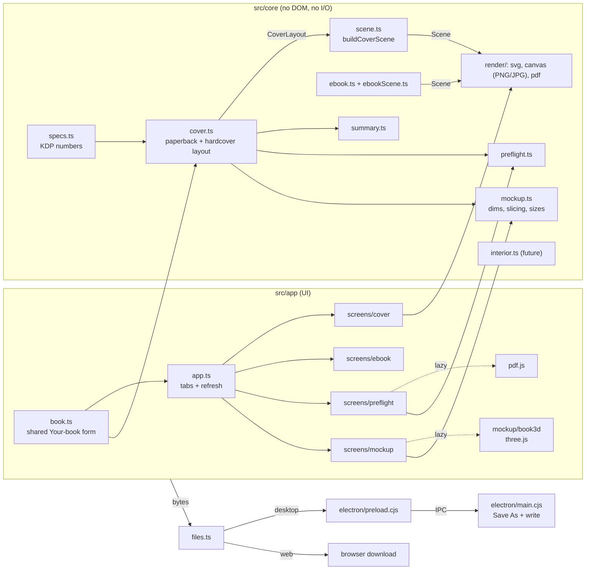

# Architecture

KDP Perfect is a TypeScript app with a **pure core** and thin shells around it. The same code runs as an Electron desktop app and as a static web app.

## Layers

| Layer | Path | Rules |
| --- | --- | --- |
| **Core** | `src/core` | Pure functions. No `window`, `document` or Node APIs, with one exception: `render/canvas.ts` needs a `<canvas>` and is only called from the UI. Units are **inches** everywhere (the eBook cover is in pixels and is drawn at 300 DPI); conversion happens at the edges. Reusable in other apps as-is. |
| **UI** | `src/app` | Vanilla TypeScript and CSS. One shared book form, one module per screen, a small shell. No framework, so the bundle stays small and there is nothing to migrate. |
| **Desktop shell** | `electron/` | Hosts the built UI, provides native Save As, and nothing else. |

## The shell and the screens

`app.ts` owns the tabs and the refresh cycle. The shared "Your book" form (`book.ts`) computes a `CoverLayout` whenever it changes. The shell redraws the **visible** screen and marks the others dirty, so a hidden screen costs nothing until it is shown. Each screen implements `{ id, refresh(), activate?(), deactivate?() }` (`context.ts`) and receives a small `Ctx` (state, save, current layout).

Heavy dependencies load on first use, so start-up stays fast and the main bundle small:

| Chunk | Loaded when | Size (min) |
| --- | --- | --- |
| main | start-up (core, pdf-lib, UI) | ~490 kB |
| `book3d` (three.js) | the 3D mockup tab is first shown | ~550 kB |
| `pdf` + worker (pdf.js) | a PDF is first opened in Preflight or the mockup | ~430 kB + 1.3 MB worker |

## The cover pipeline

1. **`specs.ts`** holds every KDP constant, paper type, trim size and page limit for both bindings (see [KDP-SPECS.md](KDP-SPECS.md)).
2. **`computeCoverLayout(input)`** returns a `CoverLayout`. For paperbacks the outer ring is bleed and the panels are the trim size; for hardcovers the ring is wrap and the panels are the boards. Either way it contains the canvas, trim box, back/spine/front panels, safe areas, spine text zone, barcode box, hinge bands, sorted guide positions and warnings. All KDP maths lives here, and it is unit-tested against KDP's calculators.
3. **`buildCoverScene(layout, {mode, dpi})`** turns the layout into a `Scene`: a flat list of rectangles, lines and text. Two modes: `template` (white page, tints, labels) and `overlay` (transparent, guides only).
4. **Renderers** walk the scene: SVG (string), canvas (PNG/JPG, tagged with DPI by `raster-meta.ts`), PDF (`pdf-lib`, page size = canvas size in points). Because every export consumes the same scene, they can't drift apart, and the on-screen preview is the SVG renderer.

The eBook cover uses the same scene types and renderers (`ebook.ts`, `ebookScene.ts`).

### Why a scene graph?

Adding a guide or label is a one-place change that shows up in the preview, the PNG, the JPG and the PDF. Renderers stay tiny and dumb.

### Actual-size exports

- **PDF**: page size is `inches × 72` points, exact. Vector, so any zoom is sharp.
- **PNG / JPG**: pixels = `round(inches × DPI)`. `raster-meta.ts` writes a `pHYs` chunk (PNG) or JFIF density (JPG), so design tools open the file at its physical size. Rounding to whole pixels can leave the image up to half a pixel short or long (1/600" at 300 DPI).
- JPG has no alpha channel, so transparent versions (the guides overlay, a transparent mockup) are PNG/PDF only; the UI disables JPG for them.

## Preflight

`preflight.ts` is two halves. `readFileFacts` pulls facts from the bytes (`pdf-lib`: page count, page size honouring rotation, crop box; images: pixel size from the browser and declared DPI from `pHYs`/JFIF). `runPreflight(layout, facts)` is pure: it compares the facts with the expected canvas and returns checks (pass/warn/fail/info) plus a diagnosis for mismatches (`diagnoseSize`: rotated, no bleed, front cover only, other binding, implied page count from the spine). Tolerances are app choices and live in constants (see [KDP-SPECS.md](KDP-SPECS.md)). `app/artwork.ts` decodes the upload (pdf.js renders PDF page 1) for the on-screen overlay.

## 3D mockup

`core/mockup.ts` is pure: the book's physical size from the layout, where the back/spine/front sit inside a full-wrap image (as fractions, so any resolution works), aspect ratios, output sizes, pose and background presets. `app/mockup/book3d.ts` is the three.js scene:

- **Paperback**: one `RoundedBoxGeometry` with six materials (fore-edge, spine, top, bottom, front, back). Page edges are generated textures tinted for the paper.
- **Hardcover**: two boards, a spine strip and a recessed page block.
- **Posing**: each pose is a list of placements plus a camera direction; `frame()` fits all books to the frame by projecting their bounding boxes, so any aspect ratio (including 1:1) is framed correctly. Dragging orbits the camera; the shadow and light stay fixed.
- **Export**: the renderer is resized to the exact output size, drawn once, encoded and restored.
- Colors are not tone-mapped, so artwork keeps its colours.

## Desktop vs web

| Concern | Desktop (Electron) | Web |
| --- | --- | --- |
| Entry | `electron/main.cjs` loads `dist/index.html` (or the Vite dev server) | Serve `dist/` from any static host |
| Saving files | `window.kdpDesktop.saveFile` → IPC → native dialog → `fs.writeFile` | `<a download>` with a Blob URL |
| Detection | `src/app/files.ts` checks for `window.kdpDesktop` | falls through to the browser path |
| Settings | `localStorage` (per-app profile) | `localStorage` |

To publish the web version: `npm run build`, upload `dist/`. `vite.config.ts` uses a relative `base`, so it works from a sub-path (GitHub Pages) too. The optional [Pages workflow](../.github/workflows/pages.yml) does this.

## Electron security model

- `contextIsolation: true`, `nodeIntegration: false`, `sandbox: true`. The page cannot touch Node.
- The preload exposes exactly one function, `saveFile`. The main process checks the sender's URL, validates the file name (basename only, allow-listed extensions), bounds the size, and lets the **user** choose the location in a native dialog.
- Navigation is locked to the app's own URL; `window.open` is denied (https links open in the OS browser).
- A strict Content-Security-Policy is injected into `index.html` at build time (`vite.config.ts`): no remote scripts, no network connections. It allows `blob:` workers and fonts only for pdf.js.
- Uploaded covers are decoded in the renderer and never leave the machine.

## Testing

| Layer | Tool | Notes |
| --- | --- | --- |
| Maths | Vitest | Golden data from the V5 workbook (16 paperback sizes) and from KDP's **live** calculator (10 hardcover and 13 paperback/custom cases); geometry and validation rules |
| Scene and renderers | Vitest | Every shape stays inside the canvas for every preset × paper × direction × binding; PDF re-parsed with `pdf-lib`; SVG structure; PNG/JPG DPI patching byte by byte |
| eBook, preflight, mockup helpers, state | Vitest | Size rules, check statuses and diagnoses, slicing and output-size maths, binding reconciliation |
| Desktop | `npm run smoke` | Launches real Electron (or a packaged exe with `--exe`), drives the UI over the DevTools protocol, and exercises every screen: all exports through the real IPC path, preflight with pdf.js, and the WebGL mockup |

## Extending

- **New trim size or paper type**: add it to `src/core/specs.ts`, add ground-truth values to a fixture, update [KDP-SPECS.md](KDP-SPECS.md).
- **New guide or label**: change `src/core/scene.ts`; every export picks it up. Add a bounds/overlap test if it adds text.
- **New export format**: add a renderer in `src/core/render/`, a button state in the screen, and an extension in the `SAVE_TYPES` allow-list in `electron/main.cjs`.
- **New mockup pose**: add an id to `POSES` in `core/mockup.ts` and a case in `poseSetup()` in `book3d.ts`.
- **New screen**: add a section and a tab in `index.html`, a module in `src/app/screens/` implementing `Screen`, and register it in `app.ts`. The reserved "Interior" tab is the next one (see the [roadmap](ROADMAP.md)).
